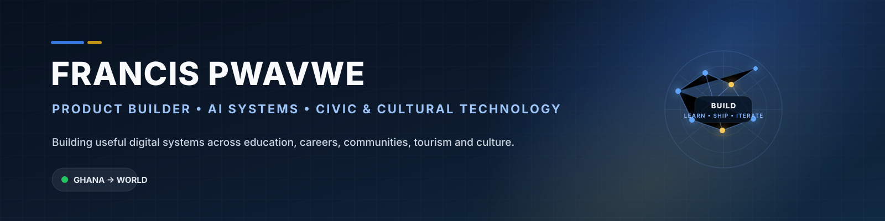

# Hey, I'm Francis Pwavwe 👋🏾

### Product Builder · AI Systems · Civic & Cultural Technology

I build websites, web applications and AI-assisted systems from **Cape Coast, Ghana** —
turning messy real-world problems into products ordinary people can actually use.

Through **Pwavwe Studios** I've shipped election, transport and campus products, and I lead
project management for **[Indigen World](https://github.com/pwavwef-web/indigen-world)**, a cultural-technology ecosystem for indigenous languages.

---

## ⚡ At a glance

- 🔭 Leading project management and cross-product consistency for **Indigen World**
- 🧭 Working across **education, careers, communities, tourism, civic systems and indigenous-language technology**
- 🌱 Digging into provider-independent AI, grounded generation and evaluation
- 🎓 Tourism Management graduate who somehow wandered into product development and never left 😅
- 🤝 Open to product collaborations, ambitious experiments and interesting problems
- 📫 Easiest to reach at [francis@pwavwe.com](mailto:francis@pwavwe.com) or [@PwavweF](https://x.com/PwavweF)

## 🚧 What I'm building now

### 🌍 [Indigen World](https://github.com/pwavwef-web/indigen-world)

A cultural-technology ecosystem for indigenous-language preservation, cultural learning, storytelling
and creator participation. It brings together three products on shared Firebase and
provider-independent AI infrastructure:

- **Indigen World Website** — the public home for programmes, stories, communities and partnerships
- **TribeStudio** — the workspace for creators, contributors and validators
- **Indigen World Mobile** — a Flutter app to explore, learn, save and contribute

It starts with **Project Kassena**, a Kasem-language programme that proves a reusable model for adding
more language communities. Community consent, licensing and cultural permissions are treated as
infrastructure, not an afterthought.

### More projects

| Project | What it is | Explore |
|---|---|---|
| **Folivera** | Career infrastructure for CV intelligence, job readiness and portable Talent Passports. | [folivera.pwavwe.com](https://folivera.pwavwe.com) |
| **Comitia** | A social/community product I'm actively prototyping and refining. | [comitia.pwavwe.com](https://comitia.pwavwe.com) |
| **AZ GPA Calculator** | Student-focused GPA/CGPA planning tools built around real university grading systems. | [Repository](https://github.com/pwavwef-web/az-gpa-calculator) |
| **Pwavwe Build** | My home for experiments, prototypes and shipped digital products. | [build.pwavwe.com](https://build.pwavwe.com) |

## 🧩 Systems I've shipped or worked on

| Area | Work |
|---|---|
| 🗳️ Civic | Digital elections and polling infrastructure |
| 🎓 Campus | University media and publishing workflows · student academic tools |
| 💼 Careers | CV and ATS intelligence |
| 🚌 Transport & service | Transport and customer-support systems |
| 🏨 Hospitality | Hospitality and tourism operations |
| 🔐 Access | Physical-digital access systems |

That variety is intentional. I like learning a domain deeply enough to turn its annoying little problems into software.

## 🧠 How I like to build

- **Problem first, technology second.** A fancy stack cannot rescue a pointless product.
- **AI should be infrastructure, not decoration.** I care about reliability, grounding, evaluation and responsible product behaviour.
- **Ship, observe, improve.** I would rather test a real workflow than endlessly debate a perfect mock-up.
- **Design for ordinary people.** Good software should reduce cognitive load, not add another manual to someone's life.
- **Local context matters.** Products built for African users should not treat bandwidth, accessibility, language or institutional realities as edge cases.

## 🧰 Toolkit

  

**Frontend:** React · TypeScript · JavaScript · Flutter  
**Backend & cloud:** Firebase Auth · Firestore · Cloud Functions · Hosting · Node.js  
**Product:** Figma · GitHub · rapid prototyping · product research · workflow design  
**Current technical interest:** provider-independent AI systems, grounded generation, evaluation and trustworthy AI-assisted product experiences

## 🌍 What I care about

Technology should do more than look impressive in a demo.

I want to build systems that **expand access, preserve identity, improve decision-making and make complicated processes easier for ordinary people to navigate** — particularly in contexts that mainstream technology often overlooks.

---

### Building from Cape Coast, Ghana for the world 🌍

**Have a problem worth solving? [Let's talk.](mailto:francis@pwavwe.com)**

